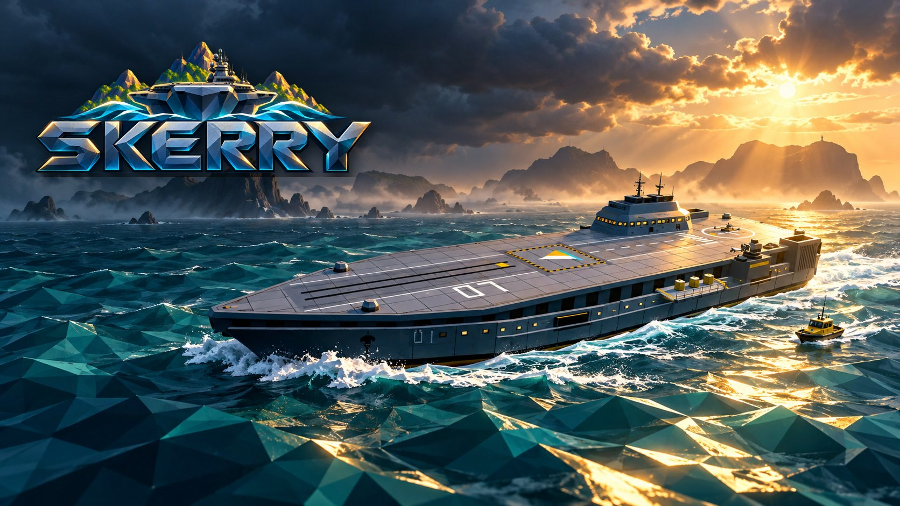
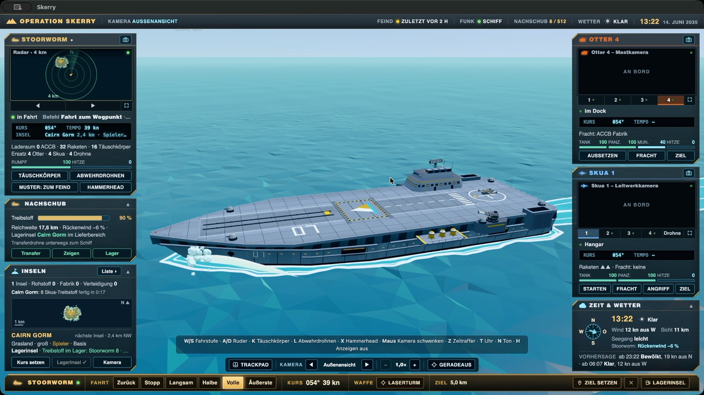
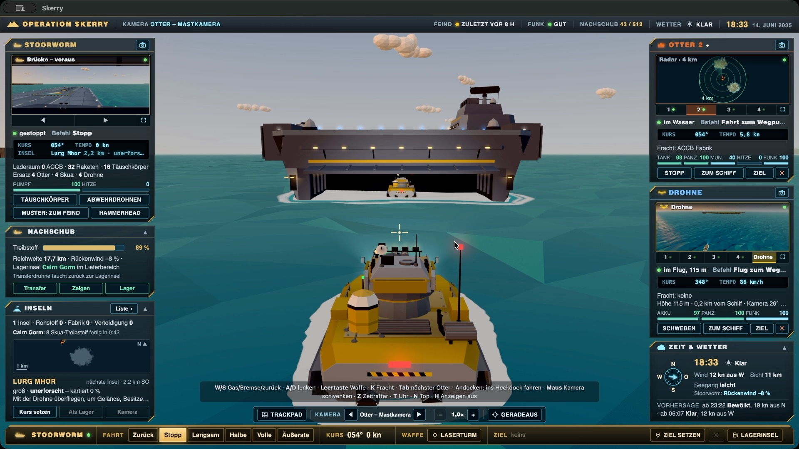
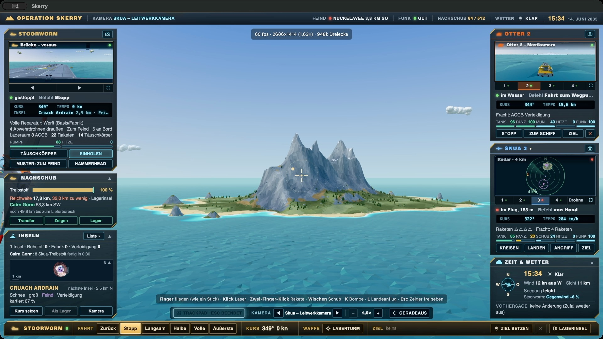
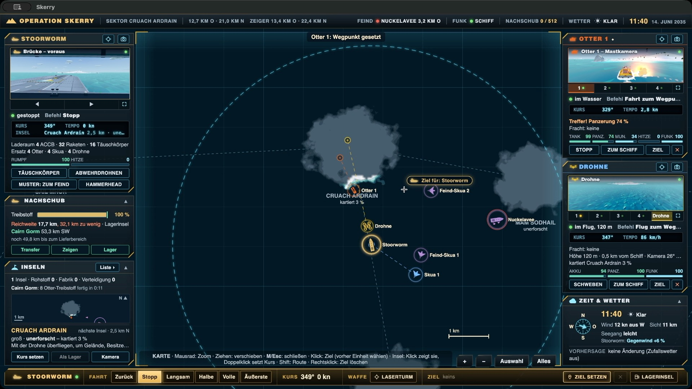
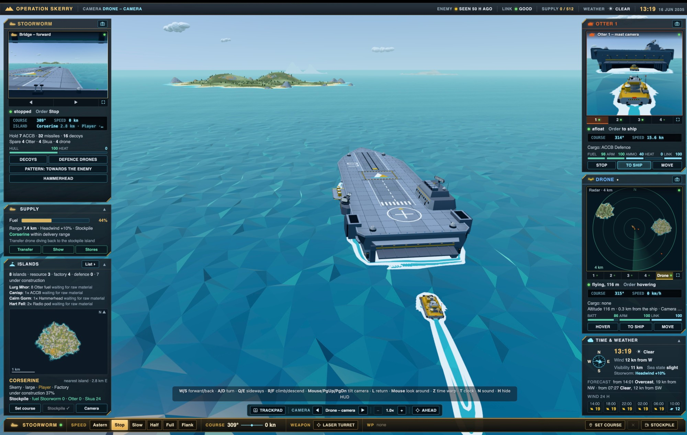
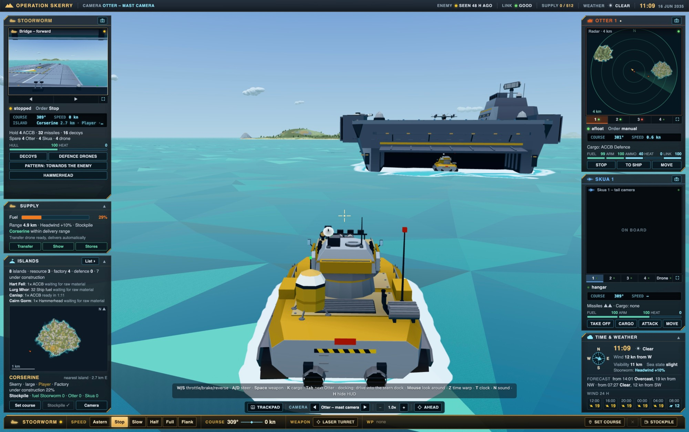
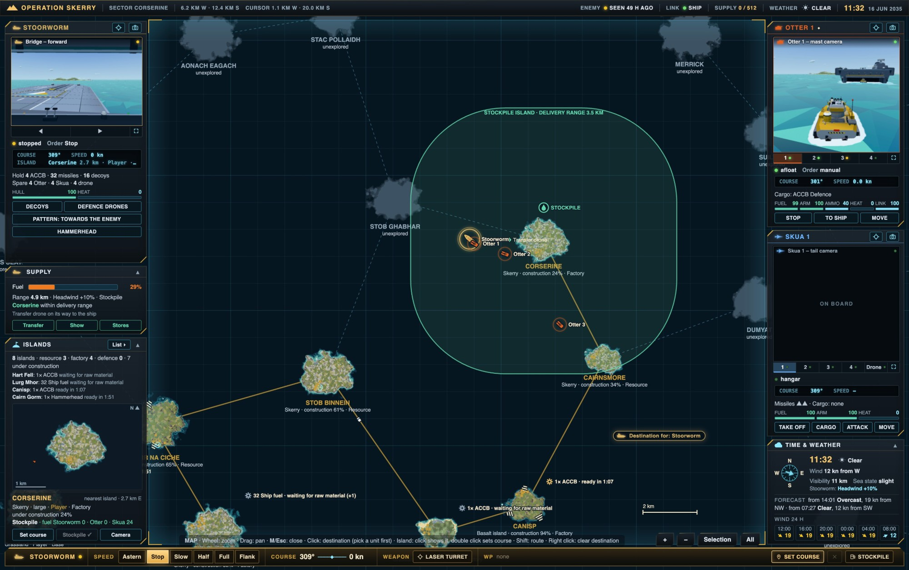

# Skerry



**Deutsch** · [English](#english)

**Im Browser spielen: [weikendo.github.io/skerry-game](https://weikendo.github.io/skerry-game/)**

Skerry ist ein Strategie- und Actionspiel auf hoher See, eine Hommage an **Carrier Command** (1988). Du führst den unbemannten Flugzeugträger **Stoorworm** durch ein Archipel im Nordatlantik, eroberst mit Amphibienpanzern (Otter) und Senkrechtstartern (Skua) Inseln, baust ein Nachschubnetz auf und kämpfst gegen den abtrünnigen Träger **Nuckelavee** und seine KI Omega. Alles in Echtzeit, in einer frei befahrbaren 3D-Welt im Low-Poly-Stil, mit Tag und Nacht, Wetter und einem Bordcomputer, der spricht.

| | |
|---|---|
|  |  |
|  |  |

## Spielen

- Läuft im Browser, direkt unter [weikendo.github.io/skerry-game](https://weikendo.github.io/skerry-game/) (am besten Chrome oder Edge auf Mac oder PC), und als Mac- oder Windows-App zum Selbstbauen.
- Steuerung mit Maus und Tastatur, Trackpad oder Gamepad. Die Einführung beim ersten Spiel, das Kampftraining im Hauptmenü und das Menü → Anleitung erklären alles Weitere.
- Deutsch und Englisch, je nach Sprache des Systems; umschalten im Hauptmenü.

## Systemvoraussetzungen

- **Computer:** Mac oder PC mit Tastatur und Maus oder Trackpad, oder mit einem Controller. Auf Handys und Tablets ohne Maus lässt sich Skerry nicht steuern, das Spiel sagt das beim Start.
- **Browser:** ein aktueller Chrome oder Edge (empfohlen). Safari läuft, spielt aber manchmal keine Musik. Nötig ist WebGL 2.
- **Grafik:** Auf einem Mac mit M3 braucht ein Bild 6 bis 12 ms (1440 × 810). Wird es knapp, senkt das Spiel die Auflösung selbst, und in den Einstellungen lässt es sich auf 30 Bilder pro Sekunde begrenzen.
- **Bildschirm:** gestaltet für 1920 × 1080, auf kleineren Bildschirmen wird die Oberfläche kompakter.
- **Mac-App:** Apple-Chip (M1 oder neuer) und macOS 13 Ventura oder neuer. **Windows-App** (selbst gebaut, nicht getestet): Windows 10 oder neuer, 64 Bit.

## Selbst bauen

Mit [Node.js](https://nodejs.org) 20 oder neuer:

```bash
npm install
npm run dev        # Entwicklungsserver auf http://127.0.0.1:5173
npm run build      # Web-Version nach dist/
npm run app:mac    # Mac-App für Apple Silicon nach release/ (app:win für Windows)
```

## Entstehung

- Spielidee, Game Design und Spieltests: **Christian Weikert**
- Programmierung und 3D-Modelle: **Claude** (Anthropic), nach den Vorgaben von Christian Weikert; die Modelle entstehen über Python-Skripte in Blender (`art/`)
- Logo und Musik („The Iron Monolith“): KI-generiert mit **Gemini** (Google); das Titelbild dieser Seite mit **OpenAI**
- Stimme des Bordcomputers: erzeugt mit **ElevenLabs**
- Klänge: Aufnahmen von BigSoundBank (Joseph Sardin) und Kenney, gemeinfrei (CC0), Quellen in `src/assets/sfx/QUELLEN.md`; Laser, Motoren, Wind und Meer entstehen im Spiel selbst
- Software: three.js und lil-gui (MIT), als App mit Electron

## Lizenz

MIT, siehe [LICENSE](LICENSE). Das gilt für den Code ebenso wie für Bilder, Musik, 3D-Modelle und die Stimme. Die eingebundenen Klangaufnahmen sind gemeinfrei (CC0).

Skerry ist ein unabhängiges, inoffizielles Fanprojekt. Es ist kein Produkt der Rechteinhaber von „Carrier Command“ (Realtime Games Software, veröffentlicht von Rainbird) und nicht mit ihnen verbunden. „Carrier Command“ ist eine Marke ihres jeweiligen Inhabers. Das Spiel enthält keine Grafiken, Modelle, Klänge oder Dateien aus dem Original.

---

## English

**Play in the browser: [weikendo.github.io/skerry-game](https://weikendo.github.io/skerry-game/)**

Skerry is a strategy and action game on the high seas, a homage to **Carrier Command** (1988). You command the unmanned aircraft carrier **Stoorworm** through an archipelago in the North Atlantic, capture islands with amphibious tanks (Otters) and VTOL jets (Skuas), build up a supply network and fight the rogue carrier **Nuckelavee** and its AI, Omega. All in real time, in a free-roaming low-poly 3D world with day and night, weather and a ship computer that talks.

| | |
|---|---|
|  |  |



### Playing

- Runs in the browser, right at [weikendo.github.io/skerry-game](https://weikendo.github.io/skerry-game/) (Chrome or Edge on a Mac or PC recommended), and as a Mac or Windows app you can build yourself.
- Mouse and keyboard, trackpad or gamepad. The tutorial in your first game, the combat training in the main menu and Menu → How to play explain the rest.
- English and German, following the system language; switch in the main menu.

### System requirements

- **Computer:** a Mac or PC with a keyboard and a mouse or trackpad, or with a controller. Skerry cannot be steered on phones and tablets without a mouse, and says so when it starts.
- **Browser:** a current Chrome or Edge (recommended). Safari works but sometimes plays no music. WebGL 2 is required.
- **Graphics:** on a Mac with an M3 a frame takes 6 to 12 ms (1440 × 810). When it gets tight the game lowers its resolution by itself, and the settings can cap it at 30 frames per second.
- **Screen:** designed for 1920 × 1080; on smaller screens the interface becomes more compact.
- **Mac app:** Apple silicon (M1 or later) and macOS 13 Ventura or later. **Windows app** (build it yourself, untested): Windows 10 or later, 64-bit.

### Building

With [Node.js](https://nodejs.org) 20 or newer:

```bash
npm install
npm run dev        # development server at http://127.0.0.1:5173
npm run build      # web version to dist/
npm run app:mac    # Mac app for Apple Silicon to release/ (app:win for Windows)
```

### Credits

- Game idea, game design and play testing: **Christian Weikert**
- Programming and 3D models: **Claude** (Anthropic), directed by Christian Weikert; the models are built by Python scripts in Blender (`art/`)
- Logo and music (“The Iron Monolith”): AI-generated with **Gemini** (Google); the picture at the top of this page with **OpenAI**
- Ship computer voice: made with **ElevenLabs**
- Sounds: recordings by BigSoundBank (Joseph Sardin) and Kenney, public domain (CC0), sources in `src/assets/sfx/QUELLEN.md`; lasers, engines, wind and sea are synthesised in the game
- Software: three.js and lil-gui (MIT), as an app with Electron

### Licence

MIT, see [LICENSE](LICENSE). It covers the code as well as the images, music, 3D models and voice. The included sound recordings are in the public domain (CC0).

Skerry is an independent, unofficial fan project. It is not a product of, nor affiliated with, the rights holders of “Carrier Command” (Realtime Games Software, published by Rainbird). “Carrier Command” is a trademark of its respective owner. The game contains no graphics, models, sounds or files from the original.
