# Look-Analyse: Spielgrafik und Titelbild

Stand 23.10.2026.

**Grundlage:**
- Referenz ist das Titelbild `src/assets/skerry-keyart.webp` (2880 × 1440).
- Das Spiel lief auf dem Dev-Server und wurde mit Headless Chrome (Metal, 1440 × 720, eigenes Profil) aufgenommen.
- Für den Hauptvergleich ist die Szene des Titelbilds nachgestellt:
  - die Stoorworm vor der Gegnerinsel **Broad Law** (Biom Berge) um 17:00 bei klarem Wetter,
  - vier Otter auf dem Wasser, vier Skuas in der Luft,
  - drei zerstörte, brennende Gebäude.
- Die Kamera ist die freie Entwicklerkamera, auf den Blickwinkel des Titelbilds eingestellt.
- Farben sind gemessen: Mittelwerte und Streuung von Bildbereichen in HSV, also so, wie sie nach Licht und Tone Mapping im Bild ankommen, nicht als Palettenwerte.
- Alle Vorschläge sind **nur zur Laufzeit** im Browser vorgeführt (Uniforms, Shader-Text, Vertexfarben, Umgebungswerte). Unter `src/`, `art/`, `index.html` und `viewer/` ist nichts geändert. Das Skript dazu liegt in `look/vorfuehrung.js`.

## Kurzfassung

- **Wo es am weitesten auseinanderliegt:**
  - **Meer:** Das Spiel zeigt eine fast einfarbige, stark gesättigte Fläche mit großen weißen Zelllinien im Wind-Waker-Stil. Im Titelbild ist das Meer ein Mosaik aus großen Dreiecken, jedes mit eigenem Ton zwischen Marine, Petrol, Türkis und hellem Glanz. Es ist vorn dunkel und zum Horizont hell.
  - **Farben:** Die Felsen sind im Spiel braun, im Titelbild schiefergrau. Das Grün ist im Spiel giftig-hellgrün (Sättigung 0,84 im Bild), im Titelbild moosig-oliv (0,35). Die Stoorworm ist fast schwarz (Deck V 0,21), im Titelbild ein blaues Gunmetal (V 0,46). Der Otter ist ocker statt gelbgrün.
  - **Licht und Luft:** Das Spiel startet um 18:12 im rosa Abendlicht. Das Titelbild entspricht etwa 16:30–17:00. Dunst beginnt im Spiel erst bei 1,8 km, das Fernmeer ist ein graues Band. Im Titelbild verschwimmen die Inseln in warmem Dunst über hellem, türkisem Fernmeer.
  - **Effekte:** Der Rauch über zerstörten Gebäuden ist im Spiel klein und hellgrau, im Titelbild sind es hohe schwarze Säulen. Kielwasser ist im Spiel scharf umrandet, im Titelbild weiß und schäumend.
- **Die drei wirkungsvollsten Vorschläge:**
  1. **Meer-Mosaik statt Zelllinien:** gröbere Facetten (14 statt 6 m), ein kleiner Höhenversatz je Ecke und eine Farbe je Facette aus ihrer Neigung, dazu Fresnel zum Horizont (`ocean.ts`).
  2. **Palette umstellen:** Fels schiefergrau, Grün oliv, Stahl ohne Lila, Stoorworm hell-blaues Gunmetal mit schwächerem Bake (`palette.ts`, `build_stoorworm.py`).
  3. **Licht und Dunst:** Start um 17:00, Bodenlicht vom Meer statt Braun, Dunst ab 400 m und ein helles türkises Fernmeer (`environment.ts`).
- **Bildrate:**
  - Die drei Vorschläge kosten praktisch nichts. Das Mosaik halbiert sogar die Ecken des Meeres (90 601 → 48 841) und spart die Zelllinien-Schleife.
  - Teuer wäre nur ein eigener Nachbearbeitungs-Pass für eine Farbkorrektur: gemessen etwa +6 ms bei 2880 × 1440.

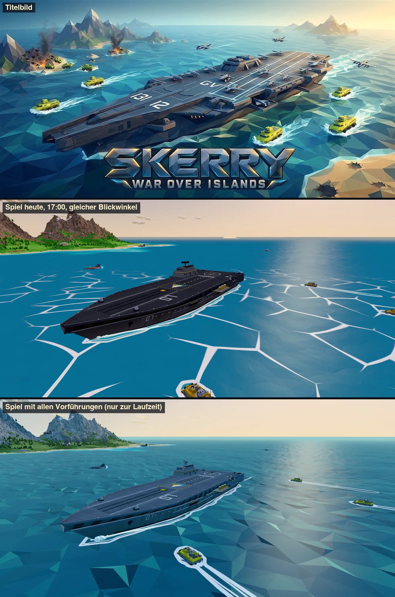

---

## Umgesetzt am 23.10.: Maßnahmen 2–5

**Was umgesetzt ist** (noch nicht committet):
- **Palette:** `fels1–4` und `gruen1–5` auf die Werte aus Maßnahme 2, `stahlHell #aeb6bf`, `stahl #97a1ad`, neue Familie `gunmetalHell/gunmetal/gunmetalDunkel/gunmetalTief`.
- **Umgebung:** Startzeit 17:00, Bodenlicht vom Meer, blaueres Himmelslicht um 17:30, `lightI 2.5`, `fogNear 400/300`, Fernmeer tagsüber aus dem Horizont zu #9dcfcf gemischt (0,6).
- **Stoorworm:** Gunmetal statt der geteilten Grautöne, Deckplatten nicht mehr abgedunkelt, Bake kürzer (Distanz 1,5, Stärke 0,45). Otter und Skua sind mit den neuen Stahlfarben neu gebaut.

**Unverändert:** Meer, Himmel, Rauch, Kameras und Otterfarbe (Maßnahmen 1 und 6–14).

**Aufnahmen:**
- Dieselben Szenen wie am Vormittag, mit denselben Abläufen und Wartezeiten, ohne Vorführung.
- Gemessen in denselben Bildbereichen. Den Fels habe ich auf den Hängen gemessen, nicht über alle Pixel.

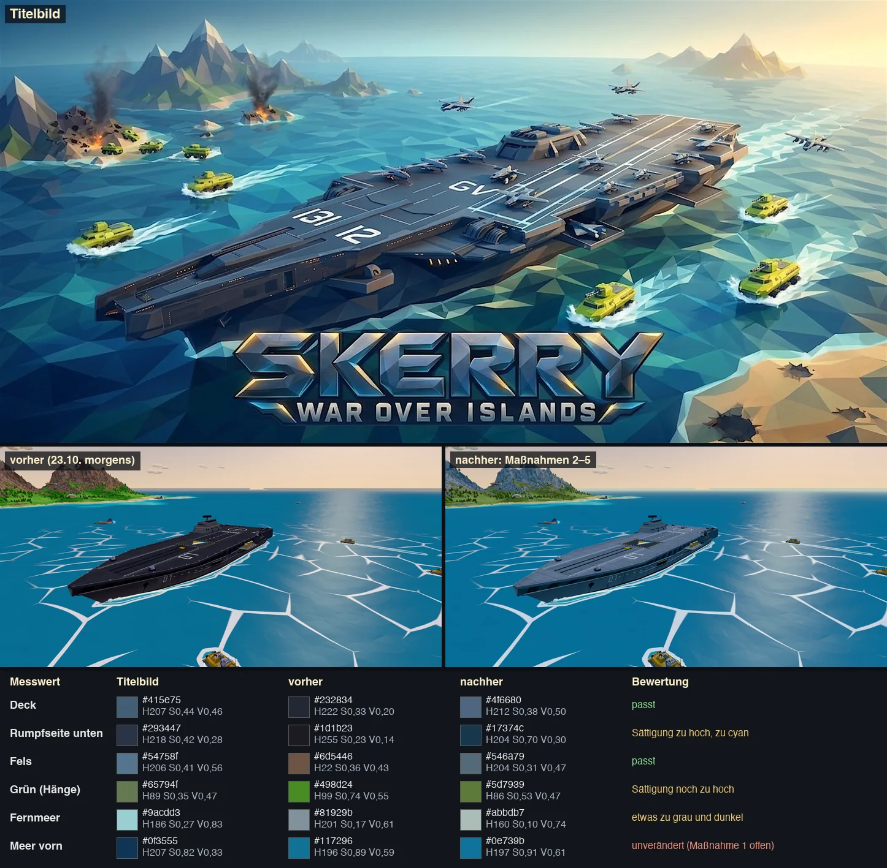

| Messwert | Titelbild | vorher | nachher | Bewertung |
|---|---|---|---|---|
| Deck | #415e75 · H207 S0,44 V0,46 | #232834 · H222 S0,33 V0,20 | #4f6680 · H212 S0,38 V0,50 | passt |
| Rumpfseite unten | #293447 · H218 S0,42 V0,28 | #1d1b23 · H255 S0,23 V0,14 | #17374c · H204 S0,70 V0,30 | Helligkeit passt, zu satt und zu cyan |
| Fels (Hänge) | #54758f · H206 S0,41 V0,56 | #6d5446 · H22 S0,36 V0,43 | #546a79 · H204 S0,31 V0,47 | passt |
| Grün (Hänge) | #65794f · H89 S0,35 V0,47 | #498d24 · H99 S0,74 V0,55 | #5d7939 · H86 S0,53 V0,47 | Ton und Helligkeit passen, noch zu satt |
| Fernmeer gegen die Sonne | #9acdd3 · H186 S0,27 V0,83 | #81929b · H201 S0,17 V0,61 | #abbdb7 · H160 S0,10 V0,74 | heller, aber grau-mint statt türkis |
| Otter-Turm | – | #46465d · H239 S0,25 V0,37 | #415366 · H211 S0,37 V0,40 | passt, kein Lila mehr |
| Meer vorn | #0f3555 · H207 S0,82 V0,33 | #117296 · H196 S0,89 V0,59 | #0e739b · H197 S0,91 V0,61 | unverändert, Maßnahme 1 offen |

**Korrekturvorschläge** (nicht umgesetzt, keine Quelldatei geändert):

1. **Unterer Rumpf zu cyan:** Die Helligkeit trifft das Titelbild (V 0,30 gegen 0,28). Das türkise Bodenlicht (`hemiGround #4c6a68`) trifft aber auf die schon blauen dunklen Gunmetal-Töne, und die Sättigung multipliziert sich (S 0,70 gegen 0,42, H 204° gegen 218°).
   - Besser die dunklen Schiffsfarben entsättigen und etwas ins Blauviolett drehen: `gunmetalDunkel #596b7f → #5f6878`, `gunmetalTief #2e3742 → #30363f`.
   - `hemiGround` so lassen, es beleuchtet alles.
2. **Grün noch zu satt:** Farbton und Helligkeit stimmen, die Sättigung ist mit 0,53 noch um die Hälfte zu hoch. Vorschlag mit zwei Dritteln der HSL-Sättigung: `gruen1–5 → #95a578, #809261, #6d7c54, #616e4a, #525d3e`.
3. **Fernmeer grau-mint statt türkis:** Die warme Horizontfarbe verdünnt das Türkis. Vorschlag:
   - `SEA_HAZE #9dcfcf → #8ccfd6` (H 186°, S 0,35) und Anteil `0.6 → 0.75` (`environment.ts:71` und `:197`).
   - Das breite helle Band des Titelbilds kommt aber erst mit der Fresnel-Spiegelung aus Maßnahme 1.
4. **Aufzug als dunkles Loch:** Der Aufzug ist noch `deckDunkel` (neutrales Grau, `build_stoorworm.py`, `'lift'`). Vor dem helleren Deck wirkt er jetzt wie ein Loch. Vorschlag: `'lift': 'gunmetal'` wie das Deck, dann markieren nur Fugen und gelbe Ecken den Aufzug.

**Ohne Korrekturbedarf:**
- **Deck:** trifft das Titelbild, etwas heller ist bei der kleineren Darstellung im Spiel eher gut.
- **Fels** und **Stahl**: passen.
- **Startzeit 17:00:** Der Titelflug zeigt jetzt Nachmittagslicht statt Rosa.

**Bildrate:** Die Änderungen betreffen nur Palette, Vertexfarben und Uniforms, ohne zusätzliche Rechenschritte. Neu gemessen habe ich nicht.

Weitere Tafeln:
- Stoorworm mit Außenkamera: [nachher_02_stoorworm.webp](look/nachher_02_stoorworm.webp)
- Insel nah und fern: [nachher_03_insel.webp](look/nachher_03_insel.webp)
- Horizont: [nachher_04_horizont.webp](look/nachher_04_horizont.webp)
- vier Tageszeiten: [nachher_05_tageszeiten.webp](look/nachher_05_tageszeiten.webp)
- Titelflug und Otter: [nachher_06_titel_otter.webp](look/nachher_06_titel_otter.webp)

---

## 1. Vergleich nach Bereichen

### 1.1 Wasser

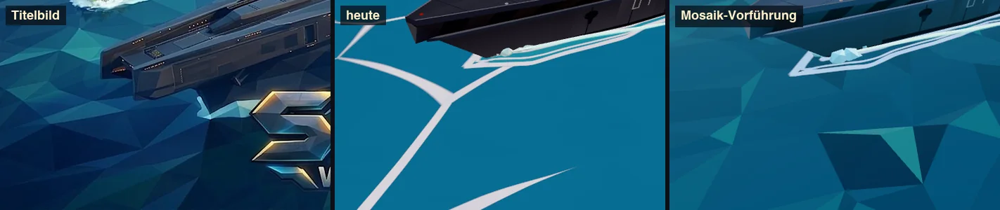

**Was abweicht:**
- **Linien statt Facetten:** Über das offene Meer laufen breite weiße Zelllinien (Worley-Rauschen mit Domain-Warp, `ocean.ts:149–201`, Schalter `uToon`). Sie sind das auffälligste Element im ganzen Bild, das Titelbild hat nichts Vergleichbares. Weiß ist dort nur Gischt an Kielwasser, Bugwellen und Ufern.
- **Einfarbig:**
  - Die Wasserfarbe hängt im Spiel nur von der Tiefe ab (`wasserFlach/Mittel/Tief`).
  - Die Facetten unterscheiden sich kaum, weil die Wellen sehr flach sind: 0,55 m Höhe auf 250 m Wellenlänge, die kürzesten 0,07–0,09 m auf 22–26 m. Die Normalen stehen fast senkrecht, das Licht macht alle Dreiecke gleich hell.
  - Gemessen: Helligkeitsstreuung im Vordergrund 16–26 (davon das meiste von den Linien), im Titelbild 24–42. Die Farbtonstreuung liegt bei 11–22° gegen 43–50° im Titelbild.
- **Facetten zu klein:** Das Raster hat 6 m (`ocean.ts:45`). Im Titelbild sind die Dreiecke etwa ein Zwölftel bis ein Zwanzigstel der Trägerlänge groß, also 12–20 m. Kleine Facetten mit viel Kontrast würden in der Ferne flimmern.
- **Kein Blickwinkel-Verlauf:** Im Titelbild ist das Wasser beim Blick nach unten dunkles Marineblau (#0f3555, V 0,33), weiter hinten Türkis und am Horizont hell (#9acdd3, V 0,83). Im Spiel ist es überall gleich gesättigt (S 0,88, V 0,58).
- **Fernmeer grau:** `seaFar` mischt die Horizontfarbe zu 55 % mit abgedunkeltem Tiefwasser (`environment.ts:189`). Das ergibt am Horizont ein graublaues Band statt des hellen, türkisen Streifens im Titelbild.
- **Sonnenglanz:** Der Glanz ist breit und grau (`specular #4f6670`, `shininess 40`). Im Titelbild ist er goldener und schmaler. Das habe ich nicht vorgeführt.
- **Rumpf unter Wasser:** Im Titelbild schimmert der Rumpf unter der Wasserlinie als hellere türkise Form durch, im Spiel nicht. Das ist eine kleine Zugabe, siehe Maßnahme 10.

**Vorführung:**
- Raster 14 m, ±0,55 m Versatz je Ecke, Farbe je Facette aus ihrer Neigung zur Sonne (16-fach überhöht), Fresnel zum Horizont, keine Zelllinien.
- Siehe Stufen 1, 2 und 5 in Abschnitt 2. Das Ergebnis kommt dem Titelbild am nächsten von allen Einzelschritten.

### 1.2 Inseln

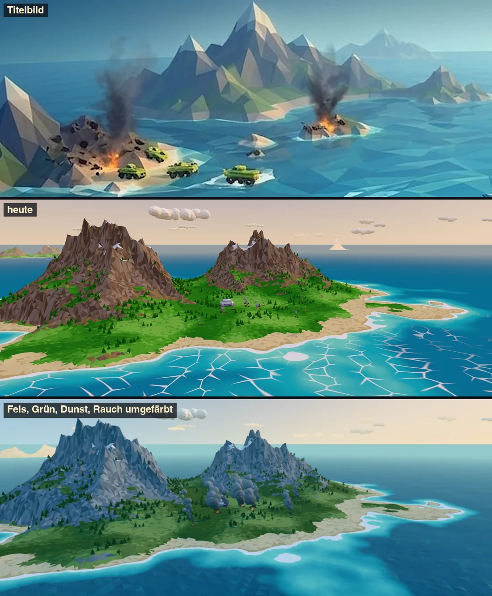

**Was abweicht:**
- **Fels:**
  - Die Palette `fels1–4` (#a6948a … #7b695d) ist warmbraun und erscheint im Bild schokoladenbraun (H 15–20°).
  - Im Titelbild ist der Fels schiefergrau mit Blaustich (H 197–207°, S 0,37–0,45, V 0,5–0,66). Die beleuchteten Flächen sind hell, die abgewandten blaugrau.
- **Grün:**
  - `gruen1–5` sind kräftiges Hellgrün (H 96–121°, S 0,54–0,62). Im Bild kommt das bei S 0,84 an.
  - Das Titelbild hat Moosgrün bis Oliv (#65794f, H 89°, S 0,35, V 0,47).
- **Facettenbild:**
  - Die Berge sind im Spiel „zerknittert“: 10-m-Raster (`island.ts:24`) und eine Gratfunktion mit 4 Oktaven (`biomes.ts:215`). Das ergibt sehr viele kleine Flächen.
  - Im Titelbild sind die Berge wenige große, klare Flächen mit spitzen, pyramidenförmigen Gipfeln.
- **Bäume:**
  - Auf den drei nahen Inseln stehen 3 376 Bäume (141 000 Dreiecke), auf Broad Law allein bis zu 1 100 Nadelbäume (`biomes.ts:198`).
  - Sie wirken als dunkle Sprenkel. Im Titelbild gibt es keine einzelnen Bäume, das Grün ist flächig.
- **Strände** passen: Sand im Titelbild #d6c39f, im Spiel #ceb48b. Die Flachwasserzone ist im Spiel weich und ohne Facetten, im Titelbild ebenfalls facettiert.
- **Inseldichte:**
  - Im Titelbild stehen vier, fünf Inseln und mehrere kleine Felsen („Schären“) auf engem Raum.
  - Im Spiel liegen die Inseln 3–25 km auseinander, kleine Felsinseln gibt es keine. Von Bord sieht man meist eine Insel und viel leeres Meer.

### 1.3 Licht und Tageszeit

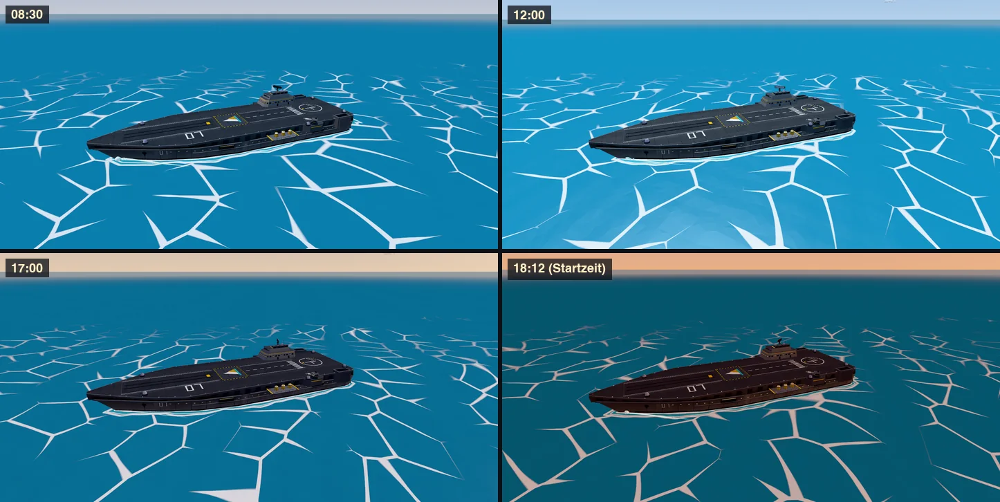

**Tageszeit:**
- Das Titelbild hat tiefes, warmes Licht von rechts hinten (Sonne kurz über dem Horizont), aber noch einen blauen Himmel. Das entspricht im Spiel etwa **16:30–17:00**.
- Das Spiel beginnt um **18:12** (`environment.ts:69`, auch der Titelflug). Zu dieser Zeit sind Himmel und Licht schon pfirsich-rosa, die Stoorworm wirkt rotbraun und das Meer petrol-dunkel (Bild unten rechts und Titelflug in 1.7).

**Licht von unten:**
- `hemiGround` ist tagsüber braun (#7a7462, um 17:30 #7a6650).
- Unter der Kamera liegt aber fast immer Meer. Im Titelbild bekommen Rumpfseiten und Unterseiten kühles, türkises Licht vom Wasser.
- Mit braunem Bodenlicht werden die Schattenseiten schmutzig-dunkel. Das ist ein Grund, warum Stoorworm und Otter-Seiten fast schwarz aussehen.

**Stärke:** Die Werte um 17:00 sind eher knapp (`lightI` 2,2–2,5). Die Vorführung arbeitet mit Faktor 1,15 auf die Sonne, wärmerem Sonnenlicht (#ffd9a8) und blauerem Himmelslicht (#9cc8f0).

### 1.4 Himmel und Dunst

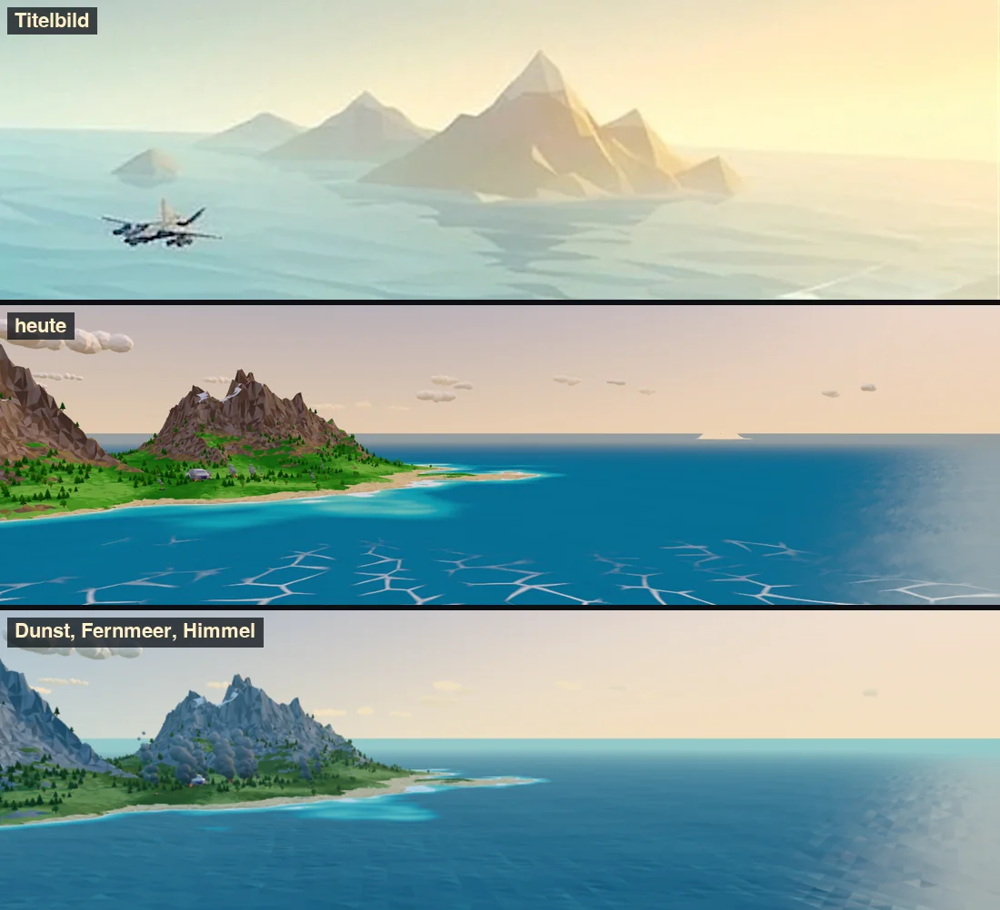

**Himmel:**
- Der Horizont hat ringsum dieselbe Farbe (`sky.ts:23`). Das Sonnenleuchten ist eng (`pow(s, 6.0) * 0.28`, `sky.ts:27`).
- Im Titelbild ist der Himmel abseits der Sonne kühl blaugrün und zur Sonne hin breit golden.

**Dunst:**
- `klar` hat `fogNear 1800` und `fogFar 11000` (`environment.ts:21`). Inseln in 2 km Entfernung haben damit praktisch keinen Dunst.
- Im Titelbild sind schon die zweiten Inseln deutlich aufgehellt, die fernen nur noch Silhouetten in warmem Dunst.
- Wichtig: **`fogFar` ist Spielmechanik.** Es bestimmt die Sichtweite für Sichtungen (`main.ts:1010`), die Anzeige „Sicht“ (`main.ts:1116`) und die Ladeweite (`main.ts:1767`). Die Vorführung hat `fogFar` für das Bild verkürzt. Für das Spiel schlage ich vor, nur `fogNear` zu senken (Maßnahme 3).

**Fernmeer:** siehe 1.1. Das graue Band unter dem Horizont trennt Meer und Himmel hart. Im Titelbild gehen sie über helles Türkis ineinander über.

**Wolken:** Das Titelbild hat keine Wolken. Die wenigen kleinen Haufen bei `klar` (`cover 0.28`) stören nicht. Für den Titelflug könnte die Bedeckung kleiner sein.

### 1.5 Schatten

- Das Titelbild lebt von der Flächenschattierung, kaum von Schlagschatten.
- Das Spiel hat weiche Schatten (PCF, Karte 4096², `main.ts:85–92`). Sie passen zum Titelbild und brauchen keine Änderung.
- Zum Vergleich: Schatten aus spart bei 2880 × 1440 etwa 4 ms (Abschnitt 4).

### 1.6 Farbsättigung und Tonwerte

Gemessene Bildfarben (Mittelwert eines Bereichs; „Streuung“ = Standardabweichung der Helligkeit 0–255, ein Maß für den Mosaik-Kontrast):

| Bereich | Titelbild | Spiel heute (17:00) | Vorführung |
|---|---|---|---|
| Meer vorn, Blick nach unten | #0f3555 · H208 S0,82 V0,33 · Streuung 24–42 | #117296 · H196 S0,88 V0,59 · Streuung 16–26 (Linien) | #085577 · H198 S0,93 V0,47 · Streuung 14–22 |
| Meer am Horizont | #9acdd3 · H186 S0,27 V0,83 | #177093 · H197 S0,84 V0,58 (darüber graues Band) | #5a94a6 · H195 S0,46 V0,65 |
| Deck | #415e75 · H206 S0,44 V0,46 | #232834 · H223 S0,32 V0,21 | #335271 · H210 S0,54 V0,45 |
| Rumpfseite | #293447 · H218 S0,42 V0,28 | #1d1b23 · H257 S0,23 V0,14 | #123c53 · H201 S0,78 V0,33 |
| Fels | #6a97a9 · H197 S0,37 V0,66 | #6d5446 · H20 S0,35 V0,43 | #506d82 · H205 S0,38 V0,51 |
| Grün (Hänge) | #65794f · H89 S0,35 V0,47 | #307c14 · H104 S0,84 V0,49 | #305e34 · H125 S0,49 V0,37 ¹ |
| Sand | #d6c39f · H39 S0,26 V0,84 | #ceb48b · H37 S0,33 V0,81 | unverändert |
| Otter | #a29e3f · H57 S0,61 V0,64 (beleuchtet #c8d040) | #765a18 · H42 S0,80 V0,47 | #688523 · H78 S0,73 V0,52 |
| Himmel nahe der Sonne | #f4e4bf · H43 S0,22 V0,96 | #ebd2ba · H30 S0,21 V0,92 | ähnlich |

¹ Die Umfärbung der Vorführung (HSL-Regel auf die vorhandenen Vertexfarben) ist zu dunkel und zu kühl geraten. Die Palettenwerte in Maßnahme 2 sind deshalb heller und wärmer als die Vorführung.

**Was das zeigt:**
- **Tonwertumfang:**
  - Das Titelbild hat ein dunkles Marine im Vordergrund, mittlere Werte auf Träger und Inseln und helle Luft. Es arbeitet mit dem ganzen Tonwertumfang.
  - Das Spiel liegt fast überall in den Mitten: das Meer mittelhell und übersättigt, die Stoorworm sehr dunkel, der Himmel hell. Es fehlen die dunklen Wasserflächen vorn und die hellen in der Ferne.
- **Sättigung:**
  - Das Titelbild ist an wenigen Stellen gesättigt: Otter, Feuer, türkise Facetten. Fels, Grün und Luft sind gedämpft.
  - Im Spiel sind Meer und Grün gleichmäßig voll gesättigt.

**Tone Mapping:**

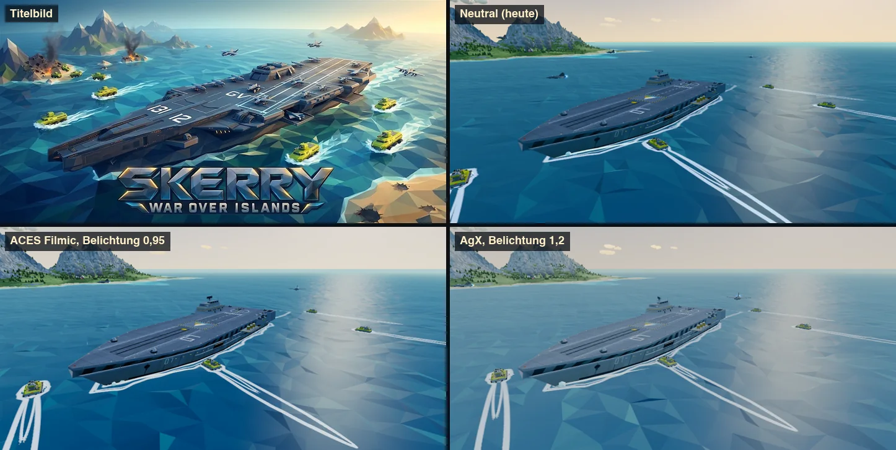

- **ACES** (Belichtung 0,95) macht das Meer satter und den Träger heller, aber den Himmel weißlich, und die goldene Wärme geht verloren.
- **AgX** wirkt flau und grau.
- **Neutral** (heute, `main.ts:71`) bleibt die beste Grundlage. Der Abstand zum Titelbild liegt an Farben und Licht, nicht an der Tonwertkurve.

### 1.7 Maßstab und Kamerawinkel

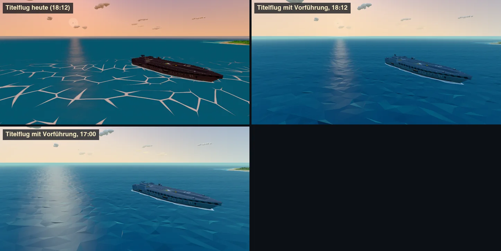

**Titelbild:**
- Die Kamera steht vorn an Backbord, etwa 30–40° neben dem Bug, und blickt mit 20–25° von oben auf das Schiff.
- Die Stoorworm füllt gut zwei Drittel der Bildbreite, der Horizont liegt bei etwa 12 % von oben, Inseln stehen dicht dahinter.

**Spiel:**
- **Außenkamera** (`cam_outside`, `build_stoorworm.py:91`: eye 235/95/105, look 0/−8/5, FOV 50): Sie steht 67° neben dem Bug und flacher. Das Schiff wirkt dadurch länger und kleiner.
- **Nachgestellter Blickwinkel:** Die Vergleichsbilder (`01`, `02`) sind mit eye 140/75/210, look 0/−8/−25 und FOV 52 aufgenommen (Schiffskoordinaten). Das trifft das Titelbild gut.
- **Titelflug** (`main.ts:1751–1760`): Radius 1,55 × Länge, Höhe 0,42 × Länge, also nur etwa 15° Neigung. Er läuft um 18:12 und vor der Graslandinsel Cairn Gorm (Start der Kampagne). Damit hat er weder Berge noch Gegenlicht wie das Titelbild.

**Maßstab:**
- Die Stoorworm ist 232 m lang (Bug +132, Heck −100), der Otter 17 m. Das Verhältnis passt zum Titelbild.
- Das Titelbild übertreibt aber die Inseln: steilere, höhere Berge, dichter beieinander. Das ist ein KI-Bild, die Maßstäbe sind nicht in sich stimmig (Panzer und Jets wirken dort sehr groß). Ziel ist die Stimmung, nicht die genaue Geometrie.

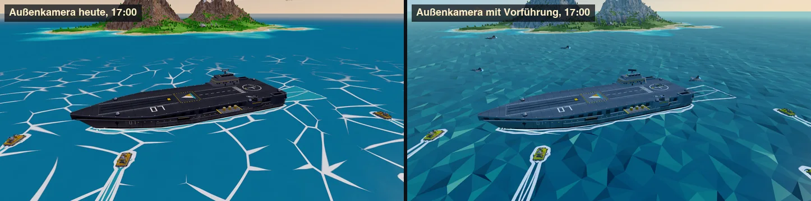

### 1.8 Modelle

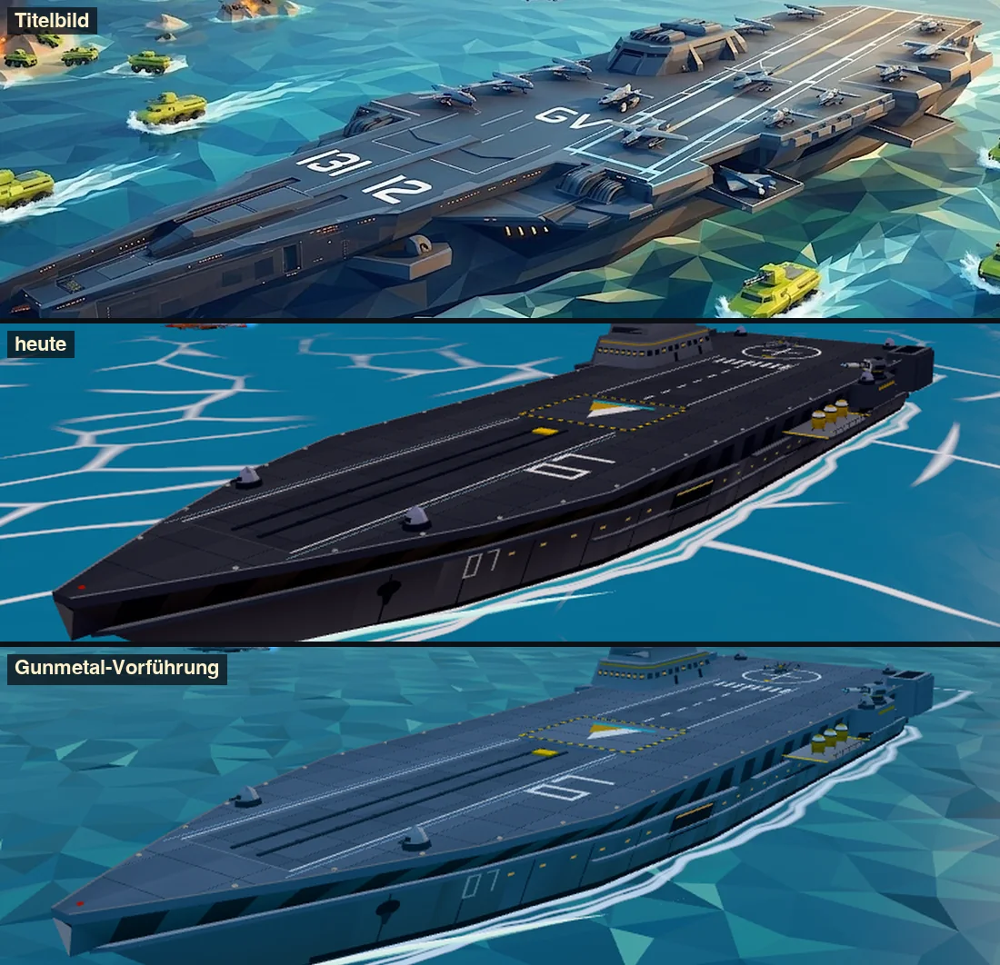

**Stoorworm:**
- Im Bild ist sie fast schwarz: Deck V 0,21, Rumpfseite V 0,14 mit einem Hauch Lila (H 257°). Im Titelbild ist sie ein helles, blaues Gunmetal: Deck V 0,46 (H 206°), Seite V 0,28.
- **Ursachen:**
  - Das gebackene Deck ist im Mittel nur noch #585b60, die Palette `deck` ist #7a8088. Der Eckenschatten-Bake dunkelt also die ganze Fläche um rund 30 % ab, nicht nur die Ecken. Die Rumpfseite liegt bei #43464b.
  - Die Grautöne sind neutral statt leicht blau.
  - Dazu kommen das braune Bodenlicht (1.3) und die tiefe Sonne um 17–18 Uhr auf einer waagerechten Fläche.
- **Details:** Das Titelbild zeigt mehr Stufen und Aufbauten, einen großen kantigen Bunker und warme Lichterreihen am Rumpf. Abgestellte Flugzeuge auf dem Deck sind bewusst nicht vorgesehen (`art/README.md`: „fährt ohne Besatzung“). Das ist Sache der Modell-Sitzung. Hier geht es nur um Farbe und Helligkeit.

**Otter:**

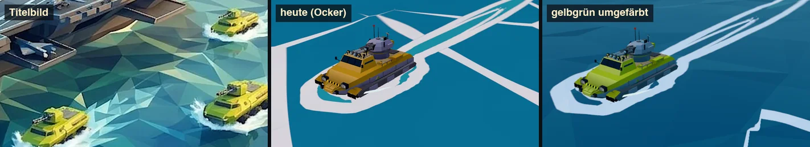

- Im Titelbild ist er gelbgrün (Chartreuse, beleuchtet #c8d040, im Schatten oliv), im Spiel Ocker (`ocker #c79b38`).
- Der Turm ist im Spiel lila-grau: `stahlHell #a7abc6` hat H 232°. Im Titelbild ist er neutral bis stahlblau.
- Ocker ist aber die Spielerfarbe aus der Original-Palette (`palette.ts:30`), und `tint.ts:12` tauscht sie für den Gegner gegen Violett. Ein Wechsel ist deshalb eine Gestaltungsentscheidung (Maßnahme 6). Gelbgrün bleibt gut vom gegnerischen Violett unterscheidbar.
- Nebenbefund: Der Blender-Otter hat 26 000 Dreiecke, mehr als die Stoorworm (18 000).

**Skua:**

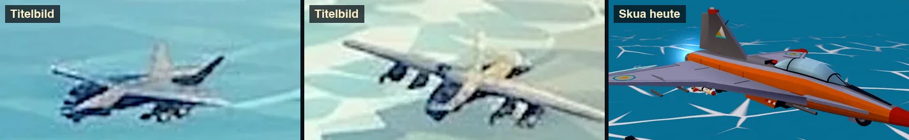

- Die Jets im Titelbild sind hellgrau mit dunklen Unterseiten.
- Die Skua ist grau mit großen signalorangen Flächen und roter Nase. Das ist auf Entfernung ein ganz anderer Eindruck. Optional, ebenfalls eine Identitätsfrage.

**Graustufen allgemein:** `stahlHell #a7abc6` und `stahl #9095b4` haben einen Lilastich (H 232°, S 0,16–0,20). Er zieht sich durch Otter-Turm, Skua, Gebäude und hellen Rauch. Im Titelbild sind alle Grautöne kühl-blau (H 205–215°).

### 1.9 Effekte

**Kielwasser und Bugwellen** (`ocean.ts:205–231`, Optionen in `main.ts:136–164`):
- Im Spiel sind sie gezeichnete Umrisse mit einem 2,4 m breiten weißen Rand, einer inneren Linie und hellerem Wasser innen (Wind-Waker-Stil). Die Otter ziehen 20 s lange, schmale Doppelschleifen hinter sich her.
- Im Titelbild sind es kurze, weiße, schäumende Fahnen mit Gischt am Bug, die nach hinten ausfransen.

**Rauch:**
- `burn()` begrenzt die Größe auf 6 m (`effects.ts:128`). Die Wolken sind 3–5 m groß, in `metall` (#6c7078) und werden nach oben fast weiß (`SMOKE_FADE = schneeSchatten`).
- Aus 1,5–2 km Entfernung sind das ein paar graue Punkte (Abschnitt 2, Stufe 0). Im Titelbild sind es schwarze Säulen, gut zehnmal so groß.
- In der Vorführung ist der Rauch 3,2-mal so groß, anthrazit, lebt doppelt so lange und steigt schneller (Bild 04, unten).

**Feuer:** Im Spiel gibt es nur einen flackernden Lichtpunkt (`halo`, Größe 3 × Feuergröße). Im Titelbild sind es orange Flammen mit Glut am Boden.

**Explosionen** sind im Titelbild nicht zu sehen und brauchen keinen Vergleich.

---

## 2. Vorführung zur Laufzeit, Schritt für Schritt

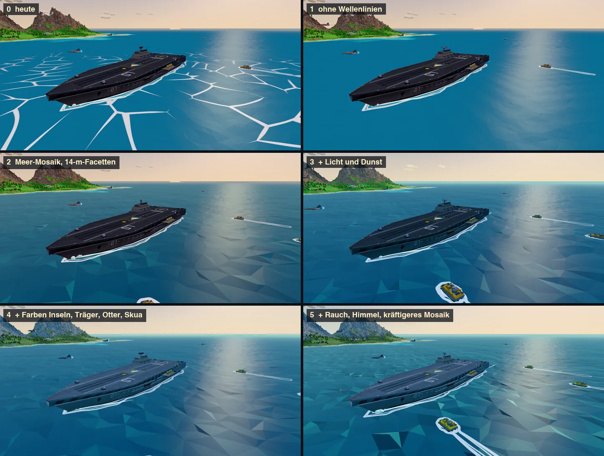

| Stufe | Was zur Laufzeit geändert wurde |
|---|---|
| 0 | Spiel heute, 17:00, klar |
| 1 | `uToon = 0`: Zelllinien aus. Allein ist das zu leer, die Linien tragen heute das ganze Meerbild. |
| 2 | Neues Meer-Netz mit 14-m-Raster, Versatz je Ecke, Mosaik-Farben je Facette, Fresnel |
| 3 | Licht: Sonne #ffd9a8 × 1,15, Himmelslicht #9cc8f0, Bodenlicht vom Meer #2f6670. Dunst: Horizont #f3e6c8, Fernmeer #9dcfcf, Nebel 300–7000 m (nur für das Bild, siehe 1.4) |
| 4 | Vertexfarben umgefärbt: Fels → Schiefergrau, Grün → Oliv, Stoorworm → Gunmetal, Otter → Gelbgrün, Skua → Grau |
| 5 | Rauch größer und dunkler, Himmel mit kühlem Horizont abseits der Sonne, Mosaik kräftiger (16-fach) |

Die Vorführung lässt sich wiederholen: Spiel im Browser öffnen, `docs/look/vorfuehrung.js` in die Konsole einfügen, dann die Aufrufe aus dem Kopf der Datei. Ein Neuladen stellt alles wieder her.

---

## 3. Maßnahmen nach Wirkung und Aufwand

| # | Maßnahme | Wirkung | Aufwand | Bildrate | Dateien |
|---|---|---|---|---|---|
| 1 | Meer-Mosaik statt Zelllinien | sehr hoch | mittel | neutral bis besser | `ocean.ts`, `palette.ts`, `main.ts` (Einstellung) |
| 2 | Insel-Palette: Fels schiefergrau, Grün oliv | hoch | klein | 0 | `palette.ts` |
| 3 | Licht und Dunst: Start 17:00, Bodenlicht vom Meer, Dunst ab 400 m, helles Fernmeer | hoch | klein | 0 | `environment.ts` |
| 4 | Stoorworm: helles, blaues Gunmetal, schwächerer Bake | hoch | klein (Modell-Sitzung) | 0 | `art/stoorworm/build_stoorworm.py`, `palette.ts` |
| 5 | Graustufen ohne Lila | mittel | klein | 0 | `palette.ts` |
| 6 | Otter gelbgrün (Entscheidung nötig) | mittel | klein | 0 | `palette.ts`, `tint.ts`, `art/otter/build_otter.py` |
| 7 | Rauch und Feuer: hohe dunkle Säulen | mittel | klein | gering | `effects.ts` |
| 8 | Himmel: kühler Horizont abseits der Sonne, breites Leuchten | mittel | klein | 0 | `sky.ts` |
| 9 | Titelflug und Außenkamera wie im Titelbild | mittel | klein | 0 | `main.ts`, `build_stoorworm.py` |
| 10 | Kielwasser und Bugwellen weiß und schäumend, Rumpf unter Wasser | mittel | mittel | gering | `ocean.ts`, `main.ts`, `spray.ts` |
| 11 | Berge steiler mit größeren Flächen, weniger Bäume | hoch | mittel bis groß (Spielbalance) | eher schneller | `biomes.ts`, `vegetation.ts` |
| 12 | Schären: kleine Felsinseln am Schelf | mittel | mittel | gering | `biomes.ts` oder `worldgen.ts` |
| 13 | Tone Mapping bei Neutral lassen, Farbkorrektur höchstens im Shader | klein | klein | Composer-Pass vermeiden | `main.ts`, `post.ts` |
| 14 | Skua mit weniger Orange (optional) | klein | klein | 0 | `art/skua/build_skua.py` |

**Reihenfolge:**
1. Zuerst 2, 3, 4 und 5: wenig Aufwand, sofort sichtbar, kein Risiko für die Bildrate.
2. Dann 1, die größte Einzelwirkung.
3. Danach 7, 8 und 9 als Feinschliff.
4. 6 und 14 brauchen vorher eine Entscheidung.
5. 10–12 sind eigene kleine Projekte.

### Maßnahme 1: Meer-Mosaik (`src/world/ocean.ts`)

**Netz:**
- `CELL = 6 → 14`, `UNIFORM = 70 → 40`, `HALF = 150 → 110` (`ocean.ts:45–47`). Die Reichweite bleibt bei etwa 24 km, das Netz hat 48 841 statt 90 601 Ecken.
- Das Einrasten in `update()` nutzt schon `CELL` und bleibt stimmig.
- Die Konstanten im Vertex-Shader (Fade-Radius `UNIFORM * CELL * 0.6/0.95`, Zellraster, Versatz `CELL * 0.7`) leiten sich davon ab.

**Facettenhub** im Vertex-Shader nach `transformed.y += frozen * 0.35;`:

```glsl
float fchop = (1.0 - smoothstep(1500.0, 4000.0, camDist)) * (1.0 - frozen);
transformed.y += (hash12(cellId + 5.0) - 0.5) * 1.1 * fchop
               * (0.65 + 0.35 * sin(uTime * 0.6 + hash12(cellId + 9.0) * 6.283));
```

Das ist nur Optik. `waveHeight()` für Auftrieb und Treffer bleibt, die Abweichung ist höchstens 0,55 m.

**Farbe je Facette** im Fragment-Shader vor dem Mischen mit Gischt, nur im offenen Wasser (`smoothstep(2.5, 14.0, depth)`). Das Flachwasser behält seine heutigen Farben:

```glsl
vec3 fn = normalize(cross(dFdx(vWorld), dFdy(vWorld))); if (fn.y < 0.0) fn = -fn;
float tilt = clamp(dot(fn.xz, normalize(uSunXZ)) * 16.0 + (fn.x * 0.7 - fn.z * 0.5) * 9.6, -1.0, 1.0);
vec3 m = mix(uNavy, uPetrol, smoothstep(-0.9, 0.0, tilt));
m = mix(m, uTeal, smoothstep(0.0, 0.7, tilt));
m = mix(m, uTurq, smoothstep(0.65, 1.0, tilt) * 0.8);
float fres = pow(1.0 - clamp(dot(fn, normalize(cameraPosition - vWorld)), 0.0, 1.0), 2.5);
m = mix(m, mix(uTeal, uGlanz, 0.55), fres * 0.75);
water = mix(water, m, smoothstep(2.5, 14.0, depth) * (1.0 - step(0.5, gi.y)));
```

- `uSunXZ` kommt in `Ocean.update()` aus `env.sunDir`.
- Bei schlechtem Wetter wirkt `uSea` wie heute weiter (Mischung zu `wasserSturm`).

**Neue Palettenfarben** (Familie „Wasser“):
- `wasserMarine #0a2b4d`, `wasserPetrol #155f80`, `wasserTeal #2a9294`, `wasserTuerkis #72c9b6`, `wasserGlanz #a8dcd8`
- Die heutigen `wasserFlach/Mittel/Tief` bleiben für Flachwasser und Kielwasser.

**Zelllinien:**
- `uToon` standardmäßig 0 und den Worley-Block (`cellEdge`, 3 × 3 Schleife) nur noch rechnen, wenn er an ist.
- Den Schalter „Wellenlinien“ (`main.ts:459`) für Liebhaber behalten oder durch „Meer-Mosaik“ ersetzen.

**Glanz** (nicht vorgeführt): `specular #4f6670 → #8a7a5a`, `shininess 40 → 70`. Das gäbe einen schmaleren, goldeneren Sonnenpfad.

**Zu prüfen:**
- Flimmern bei fahrender Kamera und in den kleinen Monitorbildern. Der Kontrast nimmt schon mit der Entfernung ab, und das Raster wird ab 560 m gröber.
- Nacht, Sturm und Nebel.
- Eisflächen sind ausgenommen (`gi.y`).

### Maßnahme 2: Insel-Palette (`src/engine/palette.ts:13–15`)

| Name | heute | neu |
|---|---|---|
| fels1 … fels4 | #a6948a, #9c8878, #8e7666, #7b695d | #9facb5, #8e9da8, #798b98, #697c89 |
| gruen1 … gruen5 | #86c75c, #62b048, #4a9a3a, #3d8636, #2f6f30 | #98b06d, #839e55, #708749, #637840, #546536 |

- **Fels:** Die neuen Werte sind kühles Grau mit leichtem Blau (H 205°, S 0,12–0,23). Den Rest des Blaustichs im Titelbild liefern Himmelslicht und Dunst, deshalb nicht blauer machen.
- **Grün:** H 82°, S 0,38–0,47. Im Bild werden daraus durch Licht und Neutral-Mapping Werte nahe am Titelbild (H ≈ 89°, S ≈ 0,35).
- Die Palette ist geteilt: Bäume, Kakteen und Palmen werden mit umgefärbt (gewollt). Prüfen in `viewer/palette.html`.

### Maßnahme 3: Licht und Dunst (`src/world/environment.ts`)

**Startzeit:** `time = 18.2 → 17.0` (`environment.ts:69`) für Titel und neues Spiel. Alternativ eine eigene Zeit für den Titelflug.

**Bodenlicht vom Meer** (`KEYS`, `environment.ts:46–48`):
- `hemiGround` für 9.5 und 14.5: `#7a7462 → #4a7276`
- `hemiGround` für 17.3: `#7a6650 → #4c6a68`
- `hemiSky` für 17.3: `#c8cce4 → #a9c8ea`
- `lightI` für 17.3: `2.2 → 2.5`
- Die Vorführung war mit #2f6670 kräftiger. Die Werte hier sind gemäßigt, weil über Land ein Teil des Bodenlichts tatsächlich bräunlich ist.

**Dunst:** `klar.fogNear 1800 → 400` (`environment.ts:21`). `fogFar` bleibt 11 000, weil es die Sichtweite im Spiel ist. Bei linearem Nebel ergibt das etwa 15 % Dunst bei 2 km und gut 40 % bei 5 km. Für `bewoelkt` entsprechend `1200 → 300`.

**Fernmeer** (`environment.ts:189`): tagsüber `seaFar = horizon.lerp(#9dcfcf, 0.6)` statt der Mischung mit dunklem Tiefwasser. Nachts und bei Sturm über `dayness()` und `w.sea` zur heutigen Rechnung zurückblenden.

### Maßnahme 4: Stoorworm (`art/stoorworm/build_stoorworm.py`, Modell-Sitzung)

**Ziel im Bild:** Deck V ≈ 0,45 und H ≈ 206°, Rumpfseite V ≈ 0,3. Heute sind es 0,21 und 0,14.

**Bake:** Den Eckenschatten kürzer machen (kleinere AO-Distanz), so dass nur Ecken und Fugen dunkel werden. Heute verliert das Deck im Mittel 30 %. Zielwert für das gebackene Deck im Mittel: ≈ #7a8b9f (heute #585b60), für die Rumpfseite ≈ #5a6a7c (heute #43464b).

**Farben:** Statt die geteilten Grautöne zu ändern, eigene Einträge für Schiffsstahl:

| Name | Wert | ersetzt |
|---|---|---|
| `gunmetalHell` | #8d9db0 | `metallHell` |
| `gunmetal` | #8697ab | `deck` |
| `gunmetalDunkel` | #596b7f | `deckDunkel` |
| `gunmetalTief` | #2e3742 | `anthrazit` |

Diese Einträge in der Tabelle `C` (`build_stoorworm.py:42–52`) für `deck`, `hull`, `hullDark`, `hullMid`, `hullLow`, `band` und `dark` verwenden.

**Rumpflichter:** Die `lights*` sind tagsüber auf 0,35 gedimmt (`nightLights`, `main.ts:409`). Mit 0,6 wären die warmen Lichterreihen am Rumpf wie im Titelbild auch am Tag zu sehen.

### Maßnahme 5: Graustufen ohne Lila (`palette.ts:28`)

- `stahlHell #a7abc6 → #aeb6bf`
- `stahl #9095b4 → #97a1ad`
- Der Farbton geht von H 232° auf 212°. Das betrifft Otter-Turm, Skua, Gebäude und hellen Rauch.

### Maßnahme 6: Otter gelbgrün (Entscheidung)

**Variante a, nur der Otter:** eine neue Familie für die Fahrzeuge des Spielers. Sie ist aus der Ocker-Familie abgeleitet, mit Farbton 66° statt 42°:
- `gelbgruenHell #ccd862`
- `gelbgruen #b9c738`
- `gelbgruenDunkel #94a02a`
- `gelbgruenGrau #b5bb7c`

`build_otter.py` verwendet sie statt `ocker*`. `tint.ts:12` und die `--feind`-Variante der Blender-Skripte bilden sie ebenfalls auf Violett ab.

**Variante b, die ganze Spielerfamilie:** Otter, Streifen und Markierungen werden gelbgrün, Ocker bleibt nur in der Oberfläche.

**Empfehlung:** Variante a. Ocker ist die Spielerfarbe aus dem Original, und das Pult nutzt sie als Akzent. Die Ocker-Akzente der Stoorworm (`accent` in `build_stoorworm.py:47`) bleiben dann, wie sie sind.

### Maßnahme 7: Rauch und Feuer (`src/world/effects.ts`)

**`burn()`** (`effects.ts:128`):
- Größe `Math.min(size, 6) → Math.min(size * 2.5, 16)`
- `every: 0.3 → 0.2`
- Lichtpunkt `em.size * 3 → em.size * 4`

**`smokePuff()` für dunklen Rauch** (`effects.ts:93–99`):
- Farbe `metall → anthrazit`
- Verblassen nach `asche` statt `schneeSchatten`
- Lebensdauer × 2
- Steiggeschwindigkeit `4 + r·4 → 7 + r·5`

Explosionen bleiben wie sie sind.

**Kosten:** mehr durchscheinende Überdeckung nahe der Kamera. Die Obergrenze `MAX_SMOKE = 400` bleibt, das sind höchstens 32 000 Dreiecke. In einem Gefecht mit mehreren brennenden Gebäuden messen.

**Später:** ein paar niedrige, orange Flammenkegel (unbeleuchtet, Palette `lava*`) am Fuß der Säule.

### Maßnahme 8: Himmel (`src/world/sky.ts:23–27`)

```glsl
float az = dot(normalize(d.xz + 1e-5), normalize(uSunDir.xz + 1e-5)) * 0.5 + 0.5;
vec3 hz = mix(uHorizonCool, uHorizon, smoothstep(0.35, 1.0, az));
vec3 col = mix(hz, uZenith, g);
// Leuchten: pow(s, 6.0) * 0.28 → pow(s, 3.0) * 0.45
```

- `uHorizonCool` kommt aus `environment.ts`, tagsüber etwa #bcdde6, abends zum Horizont hin zurückgeblendet.
- Der Nebel hat weiter eine einheitliche Farbe. Wer es genau will, gibt dem `fog_fragment` denselben Azimut-Term mit; das kostet nur ein paar Rechenschritte.

### Maßnahme 9: Kameras

**Titelflug** (`main.ts:1751–1760`):
- Höhe `len * 0.42 → len * 0.6`, Radius `len * 1.55 → len * 1.35`
- Tageszeit 17:00
- Am meisten brächte eine Insel mit Bergen im Hintergrund. Cairn Gorm ist flaches Grasland. Für den Titel könnte die Stoorworm an einer festen Stelle vor einer Berginsel liegen (ohne Einfluss auf das Spiel, das ja neu startet).

**Außenkamera** `cam_outside` (`build_stoorworm.py:91`):
- eye `(235, 95, 105) → (140, 75, 210)`, look `(0, −8, 5) → (0, −8, −25)`
- FOV in `main.ts:272` von 50 auf 52
- So sind die Vergleichsbilder aufgenommen.

### Maßnahme 10: Kielwasser, Bugwellen, Rumpf unter Wasser

**Wake-Shader** (`ocean.ts:205–231`):
- Den frischen Teil (`wk > 0.45`) mit `uFoam` füllen und facettenweise auflösen (`hash` der Facette gegen `wk`).
- Den Rand zum alten Ende hin dünner machen (`2.4 → 1.2 m`).

**Otter-Kielwasser** (`main.ts:139` und `:150`):
- `life 20 → 10`, `width1 13 → 9`
- Dann verschwinden die langen Schleifen.

**Gischt am Otter-Bug:** `OTTER_BOW.scale 0.6 → 1.0` (`main.ts:164`).

**Rumpf unter Wasser:** Innerhalb des Rumpfrings (`addRing`) das Wasser zu `wasserTuerkis` aufhellen. Dann schimmert der Rumpf wie im Titelbild durch.

### Maßnahme 11: Berge und Bäume (`src/world/biomes.ts:194–222`)

**Form:**
- Gratfunktion mit 2 statt 4 Oktaven (`this.n.ridge(…, 4) → 2`)
- Massive höher und spitzer: `240 + rnd·110 → 340 + rnd·160`, `pow(bump, 1.1) → pow(bump, 1.5)`
- Schnee erst ab etwa 300 m
- So entstehen weniger, größere Flächen, ohne dass das 10-m-Raster gröber werden muss.

**Bäume:**
- Auf Berge-Inseln `nadelbaum 1100 → 400` mit stärkerer Häufung (`clump 0.45 → 0.7`).
- Mit der neuen Palette (Maßnahme 2) fügen sie sich als Flächen ein, statt zu sprenkeln.
- Das spart etwa 40 000–60 000 Dreiecke je Berge-Insel.

**Zu prüfen:** befahrbare Täler (`SLOPE`), Bauplätze der Basen, Grundberührung des Trägers. Das berührt die Spielbalance und gehört vorher abgestimmt.

### Maßnahme 12: Schären

- Ein paar kleine Felsinseln (8–40 m hoch, 30–80 m Radius) je Insel auf dem Schelf (Landfaktor 0,2–0,45). Am einfachsten als zusätzliche Buckel in `Biome.height()`, dann gelten Grundberührung, Tiefenkarte und Flachwasserfarbe von selbst.
- Der Träger kommt dort wegen des flachen Schelfs ohnehin nicht hin, Otter fahren drum herum.
- Das gibt dem Archipel das dichte Bild des Titels und passt zum Namen.

### Maßnahme 13: Tone Mapping

- Bei `NeutralToneMapping` bleiben (Abschnitt 1.6).
- Falls später doch eine Farbkorrektur gewünscht ist (etwa mehr Sättigung in den Mitten, wärmere Lichter), dann als `THREE.CustomToneMapping` mit eigenem `tonemapping_pars_fragment`. Das läuft in denselben Shadern und kostet keinen zusätzlichen Pass.
- Einen `ShaderPass` im `EffectComposer` vermeiden, siehe Abschnitt 4.

### Maßnahme 14: Skua (optional)

- Rumpf überwiegend `stahl` mit dunkler Unterseite (`gunmetalTief`).
- Signalorange nur noch als schmale Streifen und Markierungen.

---

## 4. Bildrate

**Messung:**
- Headless Chrome mit Metal (ANGLE) auf diesem Mac, 90 Bilder (bei 2× 45) je Lauf, dreimal wiederholt, angegeben ist der Median.
- Die Zeiten umfassen Simulation und Zeichnen; die GPU ist alle vier Bilder synchronisiert.
- Bei 1× schwanken die Werte um ±2 ms, weil sich die Einheiten während der Messung bewegen (drei Läufe „heute“ ergaben 13,2, 14,9 und 17,6 ms). Bei 2× sind die Werte stabiler, weil dort die Grafikkarte begrenzt.

| ms je Bild | 1440 × 720 | 2880 × 1440 |
|---|---|---|
| heute | 13,2–17,6 | 21,4 |
| ohne Zelllinien | 13,3 | 20,8 |
| Meer-Mosaik 14 m (ohne Linien) | 15,2 | 21,2 |
| mit `EffectComposer` (Render-Target + OutputPass, ohne Bloom) | 16,4 | **27,2** |
| Schatten aus (zum Vergleich) | – | 17,3 |

**Dreiecke in der Titelbild-Szene:**
- Meer 180 000, mit 14-m-Raster 97 000
- Inseln 331 000
- Vegetation 141 000 (3 376 Bäume auf drei nahen Inseln)
- Stoorworm 18 000, je Otter 26 000
- 300–370 Draw Calls

**Was die Maßnahmen kosten:**
- **Null:** Farben, Palette, Licht, Dunst, Startzeit, Tone-Mapping-Werte (2, 3, 4, 5, 6, 13, 14). Das sind nur Uniforms oder Vertexfarben.
- **Neutral bis besser:** Meer-Mosaik (1). Halb so viele Ecken, die 3 × 3 Worley-Schleife entfällt, dazu kommen eine Normale aus Ableitungen und ein paar Mischungen. Gemessen lag es innerhalb der Streuung.
- **Praktisch null:** Himmel (8), ein paar Rechenschritte auf der Himmelskugel. Kameras (9).
- **Gering:** Rauch und Feuer (7), mehr Überdeckung durch durchscheinende Wolken. Kielwasser (10) mit etwas mehr Arbeit im Meer-Shader und mehr Gischt-Teilchen. Schären (12) mit einigen tausend Dreiecken je Insel.
- **Eher schneller:** Berge und Bäume (11), weil weniger Bäume.
- **Teuer:** Ein zusätzlicher Nachbearbeitungs-Pass kostet etwa 6 ms bei 2880 × 1440. Das ist mehr, als die Schatten kosten. Farbkorrektur deshalb nur in den Shadern (Maßnahme 13).

---

## 5. Grenzen dieser Analyse

- Das Titelbild ist KI-generiert. Maßstäbe, Licht und Perspektive sind nicht durchgehend stimmig. Es taugt als Stimmungsziel, nicht als Bauplan.
- Die Vorführungen sind Annäherungen:
  - Die Umfärbungen sind HSL-Regeln auf vorhandene Vertexfarben. Sie treffen das Grün zu dunkel, die richtigen Werte stehen in der Palette (Maßnahme 2).
  - Der Nebel ist für das Bild bis 7 km verkürzt, empfohlen ist nur `fogNear`.
- Die Szene ist gestellt: Otter und Skuas sind per `loadState` gesetzt, die Gebäude von Hand zerstört.
- Nicht geprüft:
  - Nacht, Sturm und Nebel mit dem neuen Meer
  - die kleinen Monitorbilder des Pults
  - Flimmern bei fahrender Kamera (nur Standbilder)
  - die neue Bauweise der Stoorworm, an der die Modell-Sitzung gerade arbeitet

## Anhang: Dateien

| Datei | Inhalt |
|---|---|
| `look/01_gesamt.webp` | Titelbild, Spiel heute, Spiel mit allen Vorführungen (gleicher Blickwinkel) |
| `look/02_stufen.webp` | die Vorführung in sechs Stufen |
| `look/03_meer.webp` | Meer im Vordergrund |
| `look/04_insel.webp` | Berginsel mit brennender Basis |
| `look/05_otter.webp` | Otter mit Bugwelle |
| `look/06_traeger.webp` | Stoorworm |
| `look/07_horizont.webp` | Blick gegen die Sonne, Dunst und Fernmeer |
| `look/08_tageszeiten.webp` | Außenkamera zu vier Tageszeiten |
| `look/09_tonemapping.webp` | Neutral, ACES und AgX |
| `look/10_titelflug.webp` | Titelflug heute und mit Vorführung |
| `look/11_aussenkamera.webp` | Außenkamera vorher und nachher an derselben Stelle |
| `look/12_skua.webp` | Jets im Titelbild und Skua |
| `look/vorfuehrung.js` | das Konsolenskript aller Vorführungen und der Messung |
| `look/nachher_01_gesamt.webp` | Maßnahmen 2–5: Gesamtbild vorher und nachher mit Messwerten |
| `look/nachher_02_stoorworm.webp` | Stoorworm und Außenkamera vorher und nachher |
| `look/nachher_03_insel.webp` | Insel nah und fern vorher und nachher, Fels und Grün |
| `look/nachher_04_horizont.webp` | Blick gegen die Sonne, Fernmeer |
| `look/nachher_05_tageszeiten.webp` | Außenkamera zu vier Tageszeiten, vorher und nachher |
| `look/nachher_06_titel_otter.webp` | Titelflug zur alten und neuen Startzeit, Otter-Turm |
